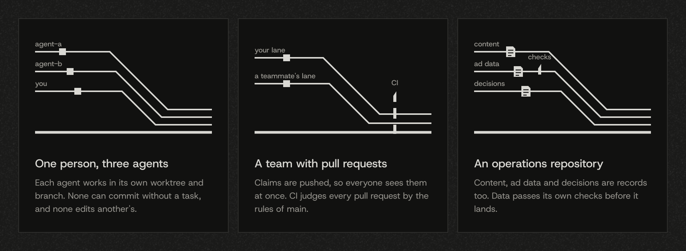
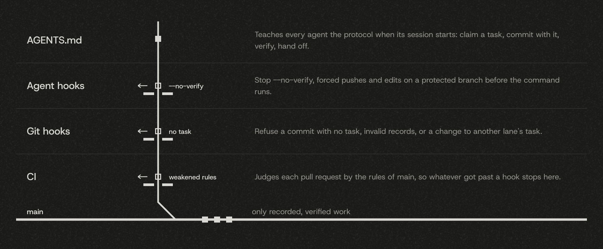

<picture>
  <source media="(prefers-color-scheme: light)" srcset="docs/assets/brand/cover-light.png">
  
</picture>

# ResaLedger

A task ledger inside your repository that coding agents can't skip, can't fake and can't collide on.

Coding agents lose track of what they were doing, say the tests pass when nobody ran them, and trip over each other when several work at once. Rules in `AGENTS.md` ask them to behave, but nothing makes them. ResaLedger keeps the work in the repository as small Markdown files, one per task, and enforces them where an agent cannot talk its way past: in git hooks, in agent hooks and in CI.

- **Can't skip.** A commit that changes code names a task its branch holds, or git refuses it. The agent hooks block `--no-verify`, and CI catches what got past a hook.
- **Can't fake.** `verify` runs your project's own checks on the committed code and stamps that exact code. A session doesn't end, and a pull request doesn't pass, on code whose checks never passed.
- **Can't collide.** A lane is a branch. Every task, decision and log entry is its own file, and only the lane that holds a task changes it, so three agents in three worktrees never edit the same file.

No dependencies, Node 20 or newer. Works with Claude Code, Codex, Cursor, Gemini CLI and GitHub Copilot, and with people.

**Status: release candidate.** 1.0.0-rc.3 is on npm under the `next` tag: until 1.0.0 is out, write `npx resaledger@next` wherever this page says `npx resaledger`. This repository is built with ResaLedger itself: its own tasks, decisions and log are in [`ledger/`](ledger/README.md).

## Quickstart

You set it up once, in a git repository with at least one commit, or ask your agent to:

```bash
npx resaledger init
```

`init` runs your project's checks once and keeps the ones that pass as gates, writes the configuration, a `ledger/` folder, the git hooks and a short protocol in `AGENTS.md`, and prints the command that commits the setup. Run that command.

After that, you mostly talk to your agents. Each one reads the protocol in `AGENTS.md` when its session starts, so when you say "do T1", it runs the daily loop itself, and the hooks hold it to it. The same commands work by hand:

```bash
npx resaledger new "Store uploads on disk"            # creates task T1
# write its goal and checks under "## Plan" in ledger/tasks/T1-store-uploads-on-disk.md
npx resaledger claim T1                               # T1 is yours now
git add -A && git commit -m "feat: store uploads" -m "Task: T1"
npx resaledger verify                                 # your checks, then a stamp for this code
npx resaledger handoff                                # may this session end?
```

`npx resaledger work` shows where everything stands, for you or for the next agent. [Working alone](docs/guides/solo.md) walks through it with real output, including three agents in three worktrees.


The demo shows the commands an agent runs in its terminal during a session, typed out here so you can follow them. It is a real run, recorded with [VHS](https://github.com/charmbracelet/vhs) from [`docs/assets/demo/demo.tape`](docs/assets/demo/demo.tape).

## How it works

<picture>
  <source media="(prefers-color-scheme: light)" srcset="docs/assets/how-it-works/how-it-works-light.svg">
  
</picture>

Three lanes work at once. Each commit carries the task it belongs to. A commit with no task stops at the gate. The lanes run together into `main` without crossing, and a stamp lands on the exact code that passed its checks.

A task is a short Markdown file that people and agents read in pull requests:

```markdown
# T1 Store uploads on disk

- Status: doing
- Lane: t1-store-uploads
- Plan: [S-storage.md](../plan/S-storage.md#uploads)
- Evidence: —

## Handoff

Uploads are written; the size limit is next. Run `npm test -- uploads`.
```

Live state is computed from the files, never kept in a status file that every branch edits. [The format reference](docs/format.md) describes every file.

## Who it is for

<picture>
  <source media="(prefers-color-scheme: light)" srcset="docs/assets/readme/use-cases-light.svg">
  
</picture>

- **One person, three agents.** Each agent works in its own worktree and branch. None can commit without a task, and none edits another's.
- **A team with pull requests.** Claims are pushed, so everyone sees them at once. CI judges every pull request by the rules of main.
- **An operations repository.** Content, ad data and decisions are records too. Data passes its own checks before it lands.

| | solo | team |
| --- | --- | --- |
| Commits on `main` | allowed | refused; work happens in lanes |
| `claim` | claims in place | creates the lane branch first, then pushes the claim |
| `handoff` asks for a pushed lane | no | yes |
| The CI workflow | offered | installed |

Switching is one line in `.resaledger.json`. [Working in a team](docs/guides/team.md) covers the required check, CODEOWNERS and squash merges.

## Where a bad commit stops

<picture>
  <source media="(prefers-color-scheme: light)" srcset="docs/assets/readme/layers-light.svg">
  
</picture>

1. **`AGENTS.md`** teaches every agent the protocol when its session starts.
2. **Agent hooks** stop `--no-verify`, forced pushes, edits on a protected branch and commands that throw away another lane's work, before the command runs.
3. **Git hooks** refuse a commit with no task, invalid records, or a change to another lane's task.
4. **CI** judges each pull request by the rules of main, reruns your checks, and fails a change that weakens the rules unless a decision names it.

| Agent | Session start | Before a tool | End of turn |
| --- | :---: | :---: | :---: |
| Claude Code | ✓ | ✓ | ✓ |
| Codex | ✓ | ✓ | ✓ |
| Cursor | ✓ | ✓ | ✓ |
| Gemini CLI | ✓ | ✓ | ✓ |
| GitHub Copilot | ✓ | ✓ | ✓ |

[Agents](docs/guides/agents.md) says what `init` writes for each one, and how to install the skill.

## What changes

| | Rules in `AGENTS.md` alone | With ResaLedger |
| --- | --- | --- |
| Where the work is recorded | wherever the agent chooses | one file per task, in the repository |
| A commit with no task | goes in | refused by the hooks and by CI |
| "The tests pass" | the agent's word | a stamp for the exact code, rerun in CI |
| Two agents, one status file | a merge conflict | no shared file: each record has one owner |
| `--no-verify` | skips every hook | blocked by the agent hooks, caught by CI |
| The next session | starts from scratch | reads the task's Handoff |

## Commands

| Command | What it does |
| --- | --- |
| `init` | Sets ResaLedger up in a repository, with the checks it found. |
| `work [--all] [--fetch]` | Where things stand: your lane, the other lanes, what is ready, what waits for you. |
| `task <id>` | One task with its plan section. |
| `new "<title>"` | A task with an id nobody else uses; also `new decision` and `new log`. |
| `claim <id>` | Takes a task; `--worktree` gives it its own branch and folder, `--take` takes one over and records it. |
| `verify` | Runs your checks on the committed code and writes its stamp. |
| `handoff` | The end-of-session check. |
| `changes` | The tasks finished since the last tag, as a draft for the changelog. |
| `ci` | The CI check. |
| `update` | Renews the guard, the hooks and the agent configurations, keeping anything you changed. |
| `migrate` | Moves an agent-ledger 0.x workspace to 1.0. |

## FAQ

**Do I need agents to use it?** No. People get the same records and the same checks. It was built for the moment several agents work at once, which is when a shared file stops working.

**Can an agent still cheat?** It can write anything into a record. It cannot commit code without a task, merge code whose checks never passed on that exact code, or change a task another lane holds, without a hook or CI refusing it. A person still reviews the pull request.

**What does it cost a solo developer?** One command to set up, and a `Task:` line in code commits. Lanes, claims across machines and CI cost nothing until you use them.

**Why files and not a database or an issue tracker?** Files are reviewed in the same pull request as the code, work offline and merge like code. Because each record is its own file and has one owner, they merge without conflicts.

**Where do my checks come from?** `init` reads `package.json`, `Makefile`, `pyproject.toml`, `Cargo.toml` and `go.mod`, runs each check once and keeps only those that pass. Fast checks run before each code commit; slow ones run in `verify` and in CI. Scripts named `test:…` or `lint:…` are listed with the command that runs them and never run, since a name does not say whether a script ends or changes files; add the ones you want to `gates` by hand.

**`npx resaledger` fails with `EOVERRIDE` or another error about the project's dependencies.** `npx` reads the project's `package.json` before it runs anything, so a dependency tree npm cannot resolve stops it. Give it an empty folder as its prefix: `npx --prefix "$(mktemp -d)" resaledger init`. npm then reads no project, and the command still runs in the current folder. Any empty folder works, also on Windows. Once `init` has run, the guard runs with `node ledger/scripts/records.mjs` and needs no npm.

**I use agent-ledger 0.x.** `npx resaledger migrate --dry-run` shows the plan. `migrate` converts the workspace in place, refuses before writing anything if a single line of the old records would be lost, and prints the commit command and the undo command. [Moving from 0.x](docs/guides/migration.md) has the details.

## Documentation

- [The docs](docs/README.md): concepts, guides for working alone, in a team, in CI and with each agent, and moving from 0.x.
- [The format reference](docs/format.md): every file and field, as the guard reads it.

## Contributing

- [Contributing](CONTRIBUTING.md): how this repository is worked, with its own ledger.
- [Code of Conduct](CODE_OF_CONDUCT.md): the Contributor Covenant 2.1.
- [Security policy](SECURITY.md): report vulnerabilities privately.
- [Changelog](CHANGELOG.md) and [release notes](https://github.com/Resaco/resaledger/releases): what changed in each version.
- [Versions and releases](docs/releasing.md): the version policy and how a release is published.

## License

[MIT](LICENSE) © Resaco Oy
