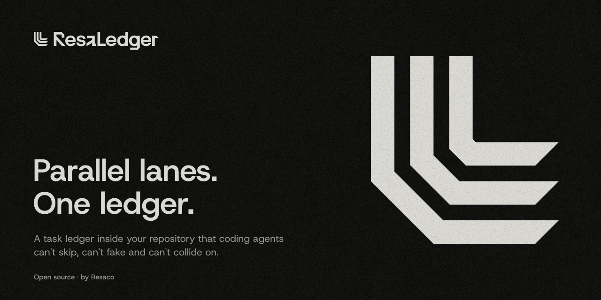

<picture>
  <source media="(prefers-color-scheme: light)" srcset="docs/assets/brand/cover-light.png">
  
</picture>

# ResaLedger

A task ledger inside your repository that coding agents can't skip, can't fake and can't collide on.

Every task, decision and log entry is a Markdown file in the repository. Git hooks and CI refuse work that is not recorded, a stamp ties a passing test run to the exact code it ran on, and parallel lanes never edit the same file, so agents and people can work side by side without merge conflicts in the records.

**Status: in development.** ResaLedger 1.0 is being built in this repository and is not ready to install yet. The build is tracked in [`ledger/`](ledger/README.md) with agent-ledger 0.3, the tool ResaLedger replaces; the repository moves to its own 1.0 format before the release.

## License

[MIT](LICENSE) © Resaco Oy
